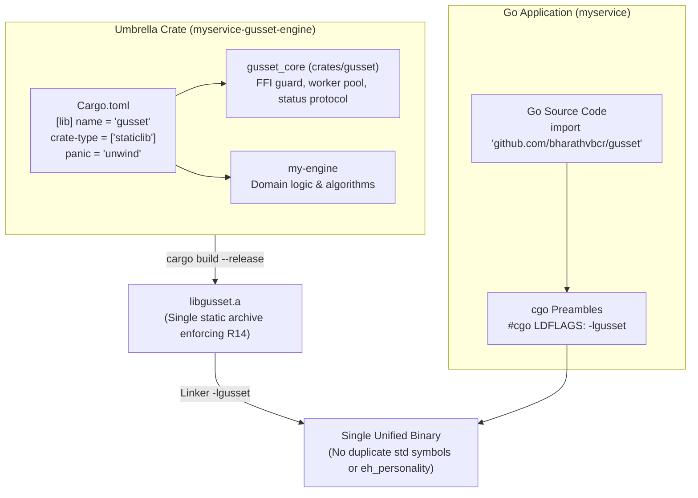
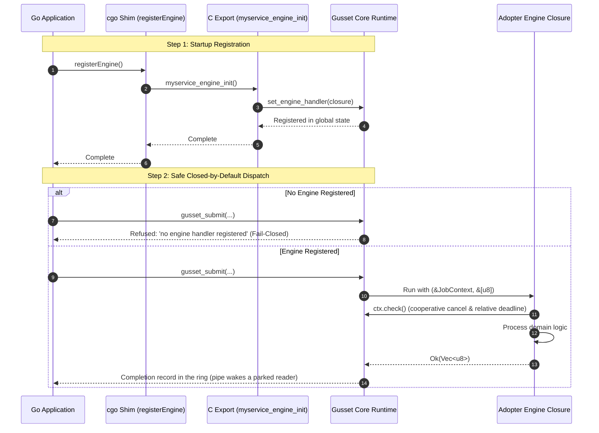
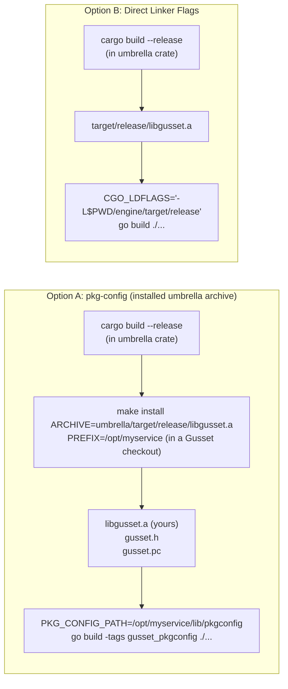

# Adopting Gusset

[Documentation Hub](README.md) · [Should You Adopt Gusset?](choosing.md) · [Archive Sealing (R14)](rfc-r14.md) · [Supported Platforms](platforms.md)

Everything here was derived by adopting Gusset in a real Go service that drives a
real third-party Rust crate, not by writing down what ought to work. The worked
example is DevCouncil's `go_orchestrator` and its `dc-glob` crate; the numbers at
the bottom are from that run.

Each step exists because skipping it produces a specific failure, named inline.

---

## 1. Build one staticlib, from an umbrella crate

R14 allows exactly one *unsealed* Rust `staticlib` per Go binary. Two of them put
std in the binary twice: under fat LTO the link fails with `rust_eh_personality`
defined twice, and without LTO it can link cleanly and quietly share one std
between engines, which is worse. An engine that cannot be built into the umbrella
is sealed instead; see [1b](#1b-an-engine-that-cannot-join-the-umbrella).

So an adopter does not link Gusset's archive *and* their engine's archive. They
build a single umbrella crate that depends on both.



**The part that is easy to get wrong:** cgo links `-lgusset`, so the umbrella's
output file must be `libgusset.a` no matter what the package is called. That is
`[lib] name`, not `[package] name`:

```toml
[package]
name = "myservice-gusset-engine"   # any name you like
version = "0.1.0"
edition = "2021"

[lib]
name = "gusset"                    # <- the output must be libgusset.a
crate-type = ["staticlib"]

[dependencies]
# Renamed, because this crate cannot also be called `gusset`. Gusset is not on
# crates.io: pin a release tag, or use `path = ".../gusset/crates/gusset"` for a
# local checkout, as the known adopters do. `Handle.Discard` (step 4) needs v0.0.3
# or later.
gusset_core = { package = "gusset", git = "https://github.com/bharathvbcr/gusset", tag = "v0.0.3" }
my-engine  = { path = "../my-engine" }

[profile.release]
codegen-units = 1
panic = "unwind"                   # R2: catch_unwind cannot catch an abort
```

`panic = "unwind"` is required — `build.rs` fails the build under `abort`, because
the panic firewall silently becomes a no-op. LTO is **your** choice: `lto = "thin"`
and `lto = "fat"` are both fine, and no Gusset invariant depends on either. Note
that a `fat`-LTO archive holds LLVM bitcode, which a system `nm` from an older LLVM
cannot read; use the toolchain's `llvm-nm` if you inspect symbols.

## 1b. An engine that cannot join the umbrella

Use the umbrella whenever you can: it costs nothing, and `register_engine(opcode, …)`
already gives each engine its own crate and owner. Seal an archive only when the
umbrella cannot hold it — a vendor staticlib with no source, an engine pinned to a
different Rust toolchain, or one whose releases must not rebuild the umbrella.

```sh
go run github.com/bharathvbcr/gusset/tools/gussetseal \
  -prefix vendor_ -o lib/libvendor.a path/to/libvendor.a
```

`gussetseal` links the archive into one object and leaves only `vendor_*`
global; the engine keeps a private std, allocator and panic runtime. COMDAT
groups and common symbols get names only this engine has (a shared personality
group crashes the second engine on its first panic). It refuses to write the
archive when anything else is still global, when nothing matches the prefix,
when the prefix claims Gusset's or Rust's names, or when the archive it wrote
does not hold exactly the object it verified. It runs on darwin (either
architecture, one per archive) and Linux (glibc and musl), which is all of
Gusset's supported set.

What changes for you once an engine is sealed:

- **Only its C ABI crosses the seal.** Never hand a `String`, `Vec`, `Box`, trait
  object or panic payload from one sealed copy to another, or to the umbrella.
  Memory goes back through the engine's own `*_free` (R4).
- **Its heap is invisible to Gusset.** `gusset.Stats()` and `AdviseMemoryLimit`
  count `libgusset.a`'s allocator only. Export the engine's own live-bytes counter
  and add it in before setting `GOMEMLIMIT`.
- **Its panics are its own.** A sealed engine must catch its own panics at its C
  ABI; it does not get Gusset's firewall, poisoned handles or deadlines unless its
  work is submitted through Gusset by an umbrella engine.
- **About 300 KB more text**, its private std (darwin/arm64, fat LTO).
- **The binary still needs external linking**, as it already does for
  `libgusset.a` alone.

`bench/r14/run.sh` is the proof and the regression test: it links two sealed
engines beside `libgusset.a` and checks panics, panic hooks, allocators and
thread-locals stay per engine (`docs/rfc-r14.md`).

## 2. Register your engine, and call the registration

Gusset exports exactly 17 C symbols and **none of them registers an engine**.
Registration is a Rust API, so the umbrella crate has to export its own entry point
for Go to call:

```rust
use gusset_core::{set_engine_handler, JobContext};

/// # Safety
/// Call once, before the first submission. Safe to call across FFI.
#[no_mangle]
pub extern "C" fn myservice_engine_init() {
    set_engine_handler(|ctx: &JobContext, input: &[u8]| -> Result<Vec<u8>, String> {
        // Cooperative cancellation between work units (I3, R9). `?` converts
        // the CancelReason into the message Go maps to context.Canceled /
        // context.DeadlineExceeded. An Err returned after a failed check is
        // reported as the cancel whatever its text, so your own wording works too.
        ctx.check()?;

        // Validate at the boundary. Return Err for bad input; never panic and
        // never `from_utf8_unchecked`.
        let text = std::str::from_utf8(input)
            .map_err(|e| format!("input is not valid UTF-8: {}", e))?;

        Ok(my_engine::run(text).into_bytes())
    });
}
```

and a small cgo shim on the Go side:

```go
package main

/*
#cgo noescape myservice_engine_init
#cgo nocallback myservice_engine_init
void myservice_engine_init(void);
*/
import "C"

func registerEngine() { C.myservice_engine_init() }
```

Call `registerEngine()` before the first `Call`, `Submit`, or `NewBuffer`.

**If you forget, every submission is refused** with

```
gusset: no engine handler registered; call gusset::set_engine_handler() before
submitting work (submission refused rather than run against a built-in engine)
```

That refusal is deliberate. Gusset ships a built-in diagnostic engine that selects
its behaviour from the first input byte — byte 1 is `panic!`, byte 2 panics with an
embedded NUL, byte 3 panics with a non-string payload. It used to run by default
whenever no engine was registered, which meant the first byte of an untrusted
payload could choose a Rust panic and poison the handle. It is now reachable only
through `gusset.WithDiagnosticEngine()`, which is for Gusset's own test suites.
Production code must never pass it.



### Which engine answers: one global slot, and one entry per opcode

The registry is **process-global**, shared by every handle in the process. It has
two parts, and an opcode picks between them (`WithOpcode` on `Open`, or
`ContextWithOpcode` for one call):

| Opcode | Served by | Installed with | A second install |
| --- | --- | --- | --- |
| `0` (the default) | the one global engine | `set_engine_handler` | **replaces** the first, with no error: the last init wins |
| nonzero `N` | the engine registered for exactly `N` | `register_engine(N, f)` | **refused** with `Err`; the first handler stays |

- **`set_engine_handler` replaces the slot.** The call is the install, and the slot
  has one occupant. Two crates in one umbrella that each call it from their own
  init do not coexist: whichever init ran last serves opcode 0 and the other
  engine is unreachable, silently. Give each engine its own nonzero opcode and
  register it with `register_engine`. The call is deliberately infallible
  (`DECISIONS.md`, 2026-09-30).
- **`register_engine` refuses a duplicate opcode, and opcode 0.** Check the
  `Result` at startup. To swap a handler, call `clear_engine_handlers` first.
- **A cleared or replaced handler is dropped when each worker that ran it next
  takes a job or exits.** Each worker keeps the engines it has run, so a job
  submitted after `clear_engine_handlers` or `set_engine_handler` returns never
  runs the removed handler, but its closure (and what it captured) is released
  late on a worker that stays idle. `Close` joins the workers, so the recipe
  below releases it.
- **The global engine serves opcode 0 only.** A handle opened with
  `WithOpcode(100)` never reaches it. Opcode 100 with no `register_engine(100, _)`
  is refused with `gusset: no engine handler registered for opcode 100 (submission
  refused)`, and the handle is not poisoned. The diagnostic engine is opcode 0
  only as well, so `WithDiagnosticEngine` does not change this. Every opcode your
  handles use needs its own registration.

### After a poisoned handle: clear, reinstall, reopen

Poison is per handle. A caught panic poisons the handle that ran the job and
nothing else, and it **leaves the process-global registry exactly as the panic
left it**. Gusset's recovery is `Close` the poisoned handle and `Open` a new one:
there is no supervisor in the library and no Go entry point for one
(`DECISIONS.md`, 2026-10-24).

What the new handle runs is the same engine closure. Whether that is enough
depends on what the panic left in the closure's captured state:

- **Stateless engine, or state the panic cannot corrupt.** `Close` and `Open` is
  all you need.
- **State behind a `std::sync::Mutex`, or anything torn halfway through an
  update.** A panic while the guard is held poisons the mutex, and
  `lock().unwrap()` (or any other use of the poisoned guard) then panics on every
  later job, on every handle. The recovered handle runs the torn engine and is
  poisoned by its first job.
  Reopening cannot fix that. The adopter must **clear the registry and install
  fresh engines.**

`clear_engine_handlers` is a Rust function, so the umbrella exports the reset, as
it exports its init (step 2 above). Have the init and the reset share one
function that installs every engine:

```rust
use gusset_core::{clear_engine_handlers, register_engine, set_engine_handler};

fn install_engines() -> Result<(), String> {
    // Fresh state for every engine, built here and not shared across calls.
    set_engine_handler(global_engine(State::new()));            // opcode 0
    register_engine(OP_SEARCH, search_engine(State::new()))     // refused if already registered
}

/// Call after Close on a poisoned handle and before the next Open.
#[no_mangle]
pub extern "C" fn myservice_reset_engines() -> i32 {
    clear_engine_handlers(); // the global engine AND every opcode entry
    if install_engines().is_ok() { 0 } else { 1 }
}
```

```go
package main

/*
#cgo noescape myservice_reset_engines
#cgo nocallback myservice_reset_engines
int myservice_reset_engines(void);
*/
import "C"

import (
	"errors"
	"fmt"

	"github.com/bharathvbcr/gusset"
)

// recoverHandle replaces a handle that returned gusset.ErrPoisoned.
func recoverHandle(bad *gusset.Handle, opts ...gusset.Option) (*gusset.Handle, error) {
	if err := bad.Close(); err != nil {
		// A worker never returned within Close's 30s budget, so the Rust pool is
		// still allocated until it exits. The engine's memory is not freed: stop
		// here, and retry the recovery later rather than resetting around it.
		return nil, fmt.Errorf("close poisoned handle: %w", err)
	}
	if C.myservice_reset_engines() != 0 {
		return nil, errors.New("engine reset failed")
	}
	return gusset.Open(opts...)
}
```

Like every Rust export your shim imports, the reset carries `#cgo noescape` and
`#cgo nocallback` (R5, checked by `gussetvet`, below). `Close` can fail, and a
failed `Close` is not a released pool (see step 4, "`Handle.Close` waits at most
30 seconds"), so the recipe reports the error and does not go on to reset or reopen.

Four things about the reset:

- **Reinstalling without clearing does not work for an opcode.** `register_engine`
  refuses the duplicate and the torn handler keeps running. Clear first. (Only
  opcode 0, whose `set_engine_handler` replaces, would take the new engine.)
- **It clears every opcode, not the one that panicked.** Reinstall all of them,
  as `install_engines` does.
- **It is not atomic.** A job another handle submits between the clear and the
  reinstall is refused with `no engine handler registered`: an error result, not a
  crash. Run the reset from one goroutine at a time, and when several handles
  poison together, reset once. A second reset would clear the fresh engines too.
- **The order against `Open` does not matter.** The engine is looked up for each
  job, not when the handle opens, so a handle opened before the reinstall runs the
  new engines. What matters is that the reinstall finishes before work resumes.

`TestChurn_PoisonedHandlesRecreateLeavingNothingBehind` shows that recovering by
`Close` and `Open` leaks nothing, over 200 poisoned handles (the default cycle count). The Rust test
`a_recovered_handle_runs_the_torn_engine_until_the_adopter_clears_and_reinstalls`
shows the case above end to end: the recovered handle runs the torn engine until
the registry is cleared and reinstalled.

## 3. Link the archive

The default `#cgo LDFLAGS` point into `target/release` **inside a Gusset source
checkout**. That directory is gitignored, so it is not in the published module and
does not exist in the module cache. Building against the module with no further
configuration gives you:

```
ld: warning: search path '.../internal/ffi/../../target/release' not found
ld: library 'gusset' not found
```



Pick one of the two supported ways out.

### Option A — pkg-config, for the umbrella archive you install

A Go binary links exactly one archive: the umbrella's (step 1). `-tags
gusset_pkgconfig` makes cgo ask `pkg-config gusset` for its flags, so the
`gusset.pc` it finds must describe *your* `libgusset.a`. Installing Gusset's own
archive does not work. It holds none of your engine's symbols, and the link fails
with `Undefined symbols ... _myservice_engine_init`.

So hand `make install` your archive. Run it in a Gusset checkout (the one your
`path` dependency points at, or a clone at the tag you depend on):

```bash
cargo build --release --manifest-path ./engine/Cargo.toml
make -C /path/to/gusset install \
  ARCHIVE="$PWD/engine/target/release/libgusset.a" PREFIX=/opt/myservice
PKG_CONFIG_PATH=/opt/myservice/lib/pkgconfig go build -tags gusset_pkgconfig ./...
```

`make install` writes `libgusset.a` (your archive, not rebuilt), `gusset.h`,
`gusset.pc` and `gussetvet` under `PREFIX`; `LIBDIR`, `INCLUDEDIR`, `BINDIR` and
`DESTDIR` override where, and the `.pc` names the directories the files
finally live in. The version in it is Gusset's, read from `Cargo.toml`. Run it
again after every umbrella rebuild: the installed archive is a copy. Paths with
whitespace are refused, because pkg-config cannot split them.

Go caches the link flags it got from `pkg-config` with the compiled cgo
package, and the cache key does not include them. Changing the prefix, or
installing a different archive into a prefix after a build that used another,
keeps linking the old `-L` directory (observed on Go 1.27.2: `library 'gusset'
not found` for a prefix that no longer exists, or `Undefined symbols` for the
wrong archive). Add `-a` to the first build after such a change:

```bash
PKG_CONFIG_PATH=/opt/myservice/lib/pkgconfig go build -a -tags gusset_pkgconfig ./...
```

`install.sh` (and `make install` without `ARCHIVE`) installs Gusset's own
archive. That is what you want for a C host or for Gusset's own diagnostic
engine, not for an adopter's Go binary.

### Option B — point the linker at the archive

Best when your umbrella crate's `target/release` is a build output of your own
repository:

```bash
cargo build --release --manifest-path ./engine/Cargo.toml
CGO_LDFLAGS="-L$PWD/engine/target/release" go build ./...
```

Both options are exercised by `tests/adopter/walkthrough.sh`, which extracts the
code blocks from this page, builds a toy adopter against a read-only copy of the
module that has no `target/` (the module-cache layout), and runs it. CI runs it
on Linux and macOS (`.github/workflows/adopter.yml`).

### Checking your shim with `gussetvet`

`make install` puts `gussetvet` in `BINDIR`. Point it at the directory holding your
cgo shim and at the list of C symbols that shim imports:

```bash
gussetvet -exports engine-exports.txt ./internal/engine
```

The list is one symbol per line (`#` comments allowed). It checks that each symbol
carries `#cgo noescape` and `#cgo nocallback` (R5), has a Go wrapper, and that
nothing in your module calls `C.free` or exports a Go callback. An empty or missing
list is an error: nothing was checked.

## 4. Use the handle

```go
h, err := gusset.Open(gusset.WithPoolSize(4))   // <= gusset.MaxPoolSize
defer h.Close()

ctx, cancel := context.WithTimeout(ctx, 100*time.Millisecond)
defer cancel()

out, err := h.Call(ctx, payload)
```

Things worth knowing before you hit them:

- **Completions travel through a shared-memory ring.** `Open` calls
  `gusset_handle_ring`. Workers publish each record into a 128-byte slot and
  the reader polls it with atomic loads. The pipe wakes a reader that has
  parked (one 8-byte token of zeros) and carries a record only when the ring
  is full. A success of at most 48 bytes is inside that record, so a small
  `Call` does not call `gusset_take`. A C host that never attaches the ring
  keeps the pipe protocol. The ring stays valid until `gusset_ring_release`,
  which the Go reader calls after `Close`.
- **Pool size is bounded** at `gusset.MaxPoolSize` (1024). Each worker is an OS
  thread with an 8 MiB stack, so the request is refused rather than clamped: a
  caller who asked for 10,000 workers and silently got 1024 keeps the wrong
  capacity model.
- **A caught panic poisons the handle**, permanently. Every later call returns
  `ErrPoisoned`. `Close` and reopen is the only way out; that is the bulkhead, not
  a bug. The process-global engine registry is not reset by a poison; step 2,
  "After a poisoned handle", says when the adopter must clear and reinstall.
- **A deadline bounds the caller, not the work.** `Call` and `Wait` return
  `ctx.Err()` when your context expires, whatever the engine is doing. The pool
  permit stays with the still-running job until it actually stops, so a caller
  walking away never lets in-flight work exceed the pool size — which also means
  a pool whose jobs all outlive their deadlines is a pool with no free permits,
  and the next `Submit` will block until one comes back. That is backpressure
  working, not a stall.
- **Cancellation itself is cooperative**, and that is a separate thing. The flag
  is only read where your engine calls `ctx.check()`, so an engine that never
  checks runs to completion regardless — nothing is interrupted, the caller is
  simply no longer blocked on it. Call `ctx.check()` inside long loops if you
  want the work to stop early rather than merely be abandoned. Check once per
  chunk (for example `for chunk in data.chunks(4096) { ctx.check()?; … }`), not
  on every iteration: a branch in the hot loop stops LLVM from vectorizing it.
  Moving the check made the example engine's sum of squares faster, but the
  size of the speedup is not backed by a committed benchmark: only the chunked
  kernel is recorded (`bench/results/linux-amd64-vm/simd.txt`), and no run
  with the check inside the loop is committed (see
  [choosing](choosing.md)). Note that `gusset.Shutdown` will report an
  engine that never checks as still in flight when its drain budget expires.
- **Pick the vector width at run time for hot kernels.** A Rust library is
  built for the baseline target unless you say otherwise: on x86-64 that is
  SSE2, 128-bit vectors, while Go's `simd` package uses AVX2 or AVX-512 when
  the CPU has them. `-C target-cpu=native` fixes that only for the machine
  that built it. Compile the same loop several times under
  `#[target_feature]` and dispatch once per call instead:

  ```rust
  pub fn kernel(chunk: &[u8]) -> u32 {
      #[cfg(target_arch = "x86_64")]
      {
          if std::is_x86_feature_detected!("avx512bw") {
              // SAFETY: the CPU reports AVX-512BW.
              return unsafe { kernel_avx512(chunk) };
          }
          if std::is_x86_feature_detected!("avx2") {
              // SAFETY: the CPU reports AVX2.
              return unsafe { kernel_avx2(chunk) };
          }
      }
      kernel_portable(chunk)
  }

  #[inline(always)]
  fn kernel_portable(chunk: &[u8]) -> u32 {
      chunk.iter().map(|&b| (b as u32) * (b as u32)).sum()
  }

  #[cfg(target_arch = "x86_64")]
  #[target_feature(enable = "avx2")]
  fn kernel_avx2(chunk: &[u8]) -> u32 { kernel_portable(chunk) }

  #[cfg(target_arch = "x86_64")]
  #[target_feature(enable = "avx512f,avx512bw")]
  fn kernel_avx512(chunk: &[u8]) -> u32 { kernel_portable(chunk) }
  ```

  The detection is one cached load. On an AVX-512 host this took Gusset's
  diagnostic kernel well below its baseline-SSE2 build; the measured figures are
  in [choosing](choosing.md) (from `bench/results/linux-amd64-vm/`), and the
  kernel is `pool::sys::sum_squares_chunk`.
- **`Handle.Close` waits at most 30 seconds.** It cancels, then *joins* its
  worker threads. An engine that checks `JobContext::check` exits promptly and
  `Close` returns `nil`. If a worker is still inside an engine call at the
  deadline, `Close` returns an error rather than wedging the caller, and a
  background thread holds the Rust pool until that worker exits. The error does
  not mean the engine's memory is freed; do not unmap or reuse anything the
  engine still references. For a tighter bound, call `gusset.Shutdown(budget)`
  first and then `Close`: the cancel has already landed, so the join is short.
  `Shutdown` is process-wide and one-way.
- **Registering an engine can fail.** `gusset_core::register_engine` returns an
  error when the opcode is already registered (the first handler stays) and
  refuses opcode 0, which dispatch never looks up. Check the result at startup.
  `set_engine_handler` is the opposite: it replaces the global engine, so the last
  init wins. Handlers are process-global: a panic poisons the handle but leaves the
  hook, and `clear_engine_handlers` removes it (the recipe is in step 2).
- **A `Submit` nobody waits on does not hold a permit.** The permit returns when
  the reader stores the result; the result stays until `Wait`, `Discard` or
  `Close`. Nothing bounds how many pile up, and one over 4 KiB is Rust memory
  the Go GC cannot see, so a fire-and-forget caller must `Discard` each ticket
  it will not `Wait` on. `Discard` drops the result only; the work still runs.
- **A ticket has exactly one waiter.** `Wait` on an unknown ticket returns
  `ErrUnknownTicket`; a second concurrent `Wait` on the same ticket returns
  `ErrTicketBusy`. Both used to park the caller forever, ignoring its context.
- **`Buffer.Bytes()` returns Rust memory.** The Go garbage collector does not trace
  it, and holding the slice does not keep the `Buffer` alive. Keep the `*Buffer`
  reachable for as long as you use its bytes, and do not use a slice after `Free`
  or `Handle.Close`. A `*Buffer` keeps its `*Handle` reachable, so a
  handle cannot be collected, and closed, while one of its buffers is still in use.
- **Buffers are 64-byte aligned on every path.** That includes a small
  `WaitBuffer` result on a poisoned handle, which is carried in aligned Go memory
  (`ID() == 0`) rather than lost.
- **Trace propagation is explicit.** Attach a value implementing
  `TraceID() [16]byte` / `SpanID() [8]byte` under `gusset.SpanContextKey`.

## 5. Zero-copy output with the stable `Allocator` trait (Rust 1.100+)

When your umbrella crate builds with Rust 1.100 or newer, `gusset_core::BufferAlloc`
implements `std::alloc::Allocator`. Build a large output directly in buffer memory
and return it. Gusset hands that allocation to Go as the result buffer. There is
no copy on the worker and none on the cgo thread, and the memory is 64-byte
aligned:

```rust
use gusset_core::{BufferAlloc, JobOutput};

gusset_core::register_engine(7, |ctx, input| {
    let mut out: Vec<u8, BufferAlloc> = Vec::new_in(BufferAlloc);
    out.try_reserve(estimate(input)).map_err(|e| e.to_string())?; // fallible
    render_into(&mut out, input, ctx)?;
    Ok(JobOutput::from(out))
});
```

- **Grow fallibly.** Use `try_reserve`. If an infallible `push` or `extend`
  cannot allocate, it aborts the whole process, Go included, and no panic
  firewall can catch an abort. The 1 GiB buffer ceiling is checked when Gusset
  adopts the output, not inside the allocator, for the same reason.
- **Accounting stays exact.** `BufferAlloc` bytes are counted once in
  `gusset.Stats()`, whether or not you install `Counting` as the global
  allocator. `Counting<A>` also works as a per-collection allocator. Wrap
  `System` or an arena with it, not a proxy for `Global`:
  `Vec::new_in(Counting::new(System))`.
- **Spare capacity is kept, not reallocated away.** Go sees `len`, and
  `Stats()` counts `capacity`. Call `shrink_to_fit` yourself if the slack
  matters. Capacity above 1 GiB is not adopted: the bytes are copied out and
  the oversized allocation freed.
- **Older compilers are unaffected.** A build-time probe
  (`crates/gusset/allocator_probe.rs`) enables all of this per compiler, and
  `gusset_core::ALLOCATOR_API` reports the result. `GUSSET_ALLOCATOR_API=0` forces
  the fallback, and `=1` turns a failed probe into a build error that prints
  the compiler's output.
- **Gate your own code on gusset's answer, not your own probe.** `gusset`
  declares `links = "gusset"` and publishes the result to direct dependents,
  so your engine crate's `build.rs` is:

  ```rust
  fn main() {
      println!("cargo::rustc-check-cfg=cfg(gusset_allocator_api)");
      if std::env::var("DEP_GUSSET_ALLOCATOR_API").as_deref() == Ok("1") {
          println!("cargo::rustc-cfg=gusset_allocator_api");
      }
  }
  ```

  A probe of your own could disagree with the one gusset compiled with.
  `crates/gusset-example` is an rlib example engine in this workspace, not a
  second staticlib to link beside `libgusset.a`. It gates on this `build.rs`,
  and its test asserts the two answers agree.
- **`JobOutput` is `#[non_exhaustive]`.** Its variants depend on the compiler,
  so an exhaustive `match` would compile on one toolchain and fail on the next.
  Add a `_ =>` arm.
- **Do not write to an input `Buffer` while its job runs.** The engine reads
  it as a Rust `&[u8]`; a concurrent Go write is a data race. Reading is fine.
- **Gusset's workers block SIGPIPE.** A completion write to a closed pipe
  returns EPIPE, and the handle then refuses new work, instead of the signal
  terminating your process. A C host should still close its read end only
  after `gusset_handle_close`.

---

## What the DevCouncil run measured

DevCouncil's `go_orchestrator` reaches its Rust kernel by spawning a subprocess per
call; its own `proc.go` documents the cost, including that a `Start` blocked in the
kernel falls outside both the context bound and `Cmd.WaitDelay`.

Adopting Gusset for `dc-glob` (`pub fn matches(pattern, name) -> bool`), on
darwin/arm64, Go 1.27.1, Rust 1.98.0:

| Check | Result |
| :--- | :--- |
| 13 glob cases through the FFI boundary | identical to Python `fnmatch.fnmatchcase`, 0 mismatches |
| 4 malformed payloads (short, truncated, over-long length, invalid UTF-8) | all returned as engine errors, none panicked, handle not poisoned |
| 12,800 calls from 64 concurrent goroutines, pool size 4 | 0 failures. Cold start 224 ms (~57k calls/sec); steady state 64–74 ms across four runs (~173k–199k calls/sec) |
| OS threads during that load | 8–10, against 64 concurrent callers (I4: callers park on the Go semaphore) |
| Expired context | refused before reaching the engine |

The thread count is the invariant worth watching: 64 concurrent Go callers produced
8–10 OS threads, because callers queue on Gusset's semaphore rather than each
pinning an M inside a cgo call.

These are historical throughput numbers for this workload on this machine,
recorded once with the toolchain named above and with no raw output committed,
not a benchmark result under R15 (nothing regenerates or checks them) — `dc-glob` is microseconds of work, so the figure is dominated by
boundary overhead, which is exactly what makes it a useful check on the boundary and
a poor proxy for a real engine. The point of comparison is not the absolute rate but
that the same work previously cost one process spawn per call.
