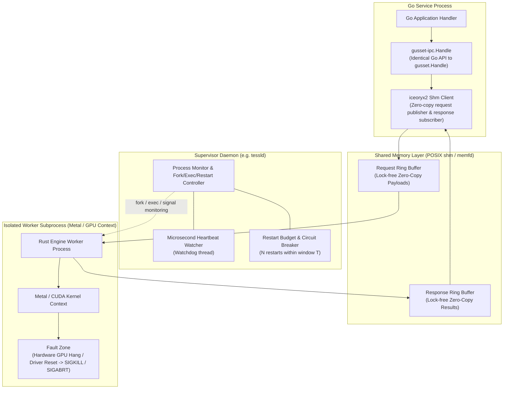
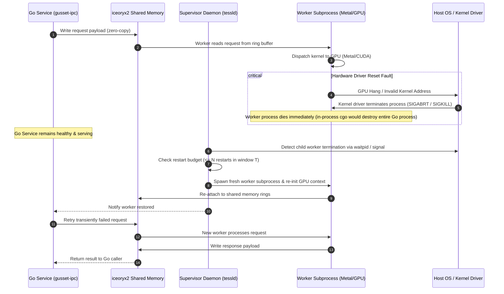

# Phase 4: Out-of-Process Crash Isolation Architecture (`gusset-ipc`)

[Documentation Hub](README.md) · [Why Gusset is Needed](why.md) · [Architecture Plan (PLAN.md)](PLAN.md)

As of 2026-11-04. Written 2026-09-20; the Transport row was revised on 2026-10-24 and the Prototype section on 2026-11-04.

## Overview

In-process crash isolation (the Gusset runtime contract) protects against software panics, stack overflows, and concurrency faults. However, engines driving GPU hardware accelerators (such as Metal in `tessl` or CUDA kernels) can trigger hardware driver reset faults (e.g. GPU hang, memory fault in kernel space). When a driver fault occurs, the host operating system terminates the process with `SIGABRT` or `SIGKILL`, which no user-space signal handler or `catch_unwind` can survive.

For GPU workloads requiring zero-downtime serving from Go, Gusset defines the Phase 4 Out-of-Process module (`gusset-ipc`).

---

## Decision Record Summary (DECISIONS.md)

| Item | Choice | Rationale |
| :--- | :--- | :--- |
| **Transport** | `iceoryx2` Go binding (in no iceoryx2 release as of v0.10.0, 2026-09-18; Gusset is contributing it, agreed on iceoryx2 #225; the move to its own repository is tracked in iceoryx2 #2104) | Zero-copy shared memory IPC with formal distribution and maintenance from Eclipse Foundation. C/C++/C#/Python bindings exist. The Go binding lives in its own release-synced repository, as `iceoryx2-csharp` does. Agreed on iceoryx2 #225 (comment 6135155559): `eclipse-iceoryx/iceoryx2-go`, with iceoryx2 as a submodule pinned to a release tag. The repository exists: it was created on 2026-10-23 through otterdog `eclipse-iceoryx/.eclipsefdn#28` and, as of 2026-10-24, holds only its initial commit and no tag or release. Its first pull request (`iceoryx2-go` #1, scaffold, CI and a minimal `NodeBuilder`/`Node`) is open and awaiting review. `gusset-ipc` pins an iceoryx2 release tag, never `main`, and seals or dynamically links `libiceoryx2_ffi_c` under R14 (`DECISIONS.md` 2026-10-12). Phase 4 cannot ship until the binding covers request/response and waitset. |
| **Adapter Role** | Thin adapter over iceoryx2 | Gusset avoids maintaining a custom shm transport. `gusset-ipc` provides the identical `gusset.Handle` Go API over IPC. |

---

## Architectural Model

## Fault Containment & Recovery Lifecycle

When driving GPU hardware, driver resets or kernel panics issue uncatchable `SIGKILL` or `SIGABRT` signals. An in-process cgo boundary cannot survive these faults; out-of-process crash isolation ensures the Go service continues uninterrupted:

---

## Daemon Supervisor Protocol

1. **Shared Memory Ring:** Requests and responses pass through bounded lock-free shared memory channels.
2. **Heartbeats:** The supervisor exchanges microsecond heartbeats with worker processes.
3. **Fault Containment:** If a Metal kernel aborts the worker, only the worker sub-process terminates. The Go service remains alive and healthy.
4. **Restart Budget:** The supervisor restarts workers up to N times within window T. If the budget is exhausted, circuit breaker opens.
5. **Transparency:** To the Go caller, `gusset-ipc.Handle` exposes the identical `Call(ctx, in)` and `Submit`/`Wait` semantics.

---

## Prototype (2026-10-08)

`internal/isolate` is the spike that tests point 5 before any transport work. It is internal. It adds no Go entry point and no Rust export: the public surface stays 13 Go entry points and 17 Rust exports. `DECISIONS.md` 2026-10-08 records the first spike. `DECISIONS.md` 2026-11-04 records the supervisor. That row does not reopen the 2026-10-24 decision: an in-process handle still recovers by `Close` then `Open`, and package `gusset` has no supervisor.

- **Transport stand-in:** length-prefixed JSON frames, the house process contract: requests on the worker's stdin, responses on a protocol pipe that `isolate.Start` appends to `cmd.ExtraFiles` (descriptor 3 when the caller passed no other extra files) and names in `GUSSET_ISOLATE_PROTOCOL_FD`. An existing `GUSSET_ISOLATE_PROTOCOL_FD` in the command's environment is replaced, so a copied environment cannot leave the child pointed at a dead descriptor. Protocol version stays 1. The worker's stdout stays its own, so an engine's `println!` cannot corrupt the framing (`DECISIONS.md` 2026-10-24). It copies every payload and base64-encodes it, so it says nothing about iceoryx2's cost; it exists so the API question can be answered without waiting on the binding.
- **Worker:** `isolate.Serve(os.Stdin, out, handle, poolSize)`, with `out` from `isolate.ProtocolOut()`, runs an ordinary `*gusset.Handle` and announces its pool size, which the host uses as its semaphore (R11). Each job is `Submit` then `Wait`.
- **Host:** `isolate.Start(ctx, cmd)` returns a `*Proc` with `Call`, `Submit`, `Wait`, `Discard` and `Close`, the same methods and errors as `*gusset.Handle`. `*Proc` stays poison-on-death. `isolate.Supervise(ctx, factory, policy)` returns a `*Supervisor` with the same five methods. `ctx` is the supervisor lifetime and is what `Start` uses; nothing starts until the first `Call` or `Submit`. `*Supervisor` is not a parity mode. `forEachMode` is still the in-process handle and `*Proc`, and the parity tests run every assertion against those two.
- **Fault containment:** a worker that dies of SIGKILL or SIGABRT fails its in-flight tickets with an error matching `gusset.ErrPoisoned`. The host keeps running. A `*Proc` refuses a later submission the same way; a result the reader already stored is still returned by `Wait`. On a `*Supervisor`, that death retires the generation. The in-flight payload is not submitted again. The retry drawn in the lifecycle above is the specified `gusset-ipc` daemon, not this spike.
- **Restart budget (point 4) is prototyped** in `internal/isolate` only. `DefaultPolicy` is 3 restarts in one minute. `MaxRestarts < 0` and a `Window` that is not positive are refused. A zero `Policy` is refused, not treated as the default. `MaxRestarts` 0 is one process and no replacement. A generation is retired when the child is reaped (a signal included), when the reader hits EOF or a hard error, on one `ErrPanic` or `ErrPoisoned` response, or when `poisonStream` cuts the frame. One poison and the exit that follows are one restart. A panic or a cut frame can leave the child process alive; the supervisor kills that child from its own goroutine and does not call `Proc.Close`, so a stored result can still be waited. `Supervisor.Close` latches do-not-restart before it closes. A mode-9 sleep does not retire. One `Start` per replacement is shared by concurrent callers. A failed hello spends one restart and is returned while the supervisor is still running; that call does not loop. Ending the supervisor lifetime does not spend a restart. Once the budget is spent, calls fail with `ErrPoisoned`'s code and message `isolate: restart budget exhausted (%d restarts in %s)`. Caller ticket ids are the supervisor's and stop at `1<<63` without wrapping. `Proc.Wait`, `Proc.Discard` and the cancel frame use the child id.
- **Heartbeats (point 2) stay specified and are not implemented.** A ping on the data pipe would share the lock `Serve` holds across `writeFrame` of a response of up to `MaxBufferBytes`, and timing that ping out can false-kill a worker that is still writing the response. A side-channel ping stays green while a Rust or GPU thread is stuck, because `Serve` runs each job as `Submit` then `Wait`.
- **`Pdeathsig` is not used.** Go's `SysProcAttr.Pdeathsig` fires when the creating thread dies, which can happen while this process is still alive (Go issue 27505), and macOS has no such attribute. A host `SIGKILL` can still leave the child running.
- **Not carried:** `NewBuffer`, `CallBuffer` and `WaitBuffer`. A `*gusset.Buffer` from `NewBuffer`, or a `WaitBuffer` result over 4 KiB or in an engine's own buffer, is Rust memory in the calling process, so the out-of-process equivalent is the shared segment this document assigns to iceoryx2. `Proc.Submit` refuses a `*Buffer` with `isolate.ErrBufferUnsupported`. `TestParity_BufferInputDiverges` pins that difference. A public carrier needs three things the prototype does not decide: a third `Buffer` backing beside the Rust id and the Go-heap id 0 (`newHeapBuffer`); an ownership rule for a segment whose worker has died; and a buffer budget charged on the host side.

Run it with `go test ./internal/isolate/`.
