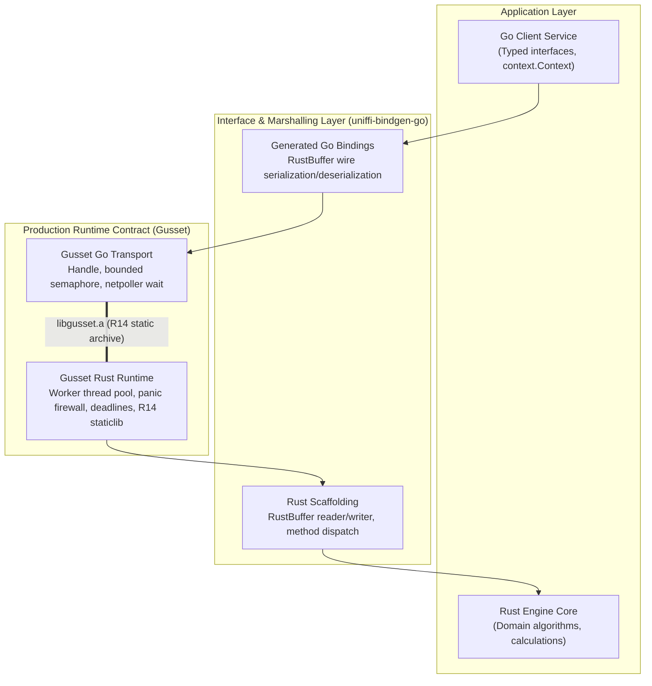

# uniffi-bindgen-go Interop with Gusset

This directory demonstrates how the **Gusset** production runtime contract hosts and operates with **uniffi-bindgen-go** (NordSecurity's Go binding generator for Mozilla UniFFI).

---

## 1. Architectural Division of Labor

A common anti-pattern in Go–Rust systems programming is expecting a binding generator to provide production runtime safety. Binding generators and runtime contracts address fundamentally different layers of the system:



| Layer | Component | Primary Ownership | What It Does NOT Own |
| :--- | :--- | :--- | :--- |
| **Interface / Marshalling** | `uniffi-bindgen-go` | Typed records, enums, interfaces, binary serialization via `RustBuffer` | Concurrency bounds, panic containment, OS thread management, deadlines, static linking |
| **Runtime Execution Contract** | `gusset` | Bounded worker thread pool, panic firewall (`catch_unwind`), context deadline propagation, handle poisoning, single staticlib archive (`libgusset.a`) | High-level data types, IDL schemas, language-specific code generation |

---

## 2. Why Raw UniFFI in Go Fails Under Production Workloads

When teams adopt raw UniFFI generated bindings directly in Go backend services without an intermediary runtime contract, they routinely encounter four fatal failure modes under scale:

### 1. OS Thread Exhaustion Under Goroutine Concurrency
Go's scheduler multiplexes thousands of lightweight goroutines onto `GOMAXPROCS` OS threads. However, raw cgo calls generated by UniFFI block the calling OS thread. If an incoming burst of 5,000 HTTP requests invokes a Rust computation via raw cgo:
- The Go runtime enters `entersyscall` and spawns a new OS thread for each waiting goroutine (`runtime/metrics /sched/threads/total`).
- Within milliseconds, the process exhausts OS thread limits or exceeds Linux `vm.max_map_count`, crashing the service with `runtime: failed to create new OS thread`.
- **Gusset's Fix:** Gusset enforces a bounded worker thread pool (`WithPoolSize(N)`). Goroutines park cooperatively on Go channels and the netpoller, bounding OS threads to a fixed, deterministic number regardless of goroutine concurrency.

### 2. Process Abort on Uncaught Rust Panics
In Rust, an uncaught panic across an `extern "C"` boundary without unwinding containment causes an immediate, unrecoverable `SIGABRT` of the host process. A single bug, out-of-bounds index, or `unwrap()` in the Rust engine brings down the entire Go server.
- **Gusset's Fix:** Gusset wraps every work unit in a strict `catch_unwind` panic firewall (Rules R2 & R3). Caught panics latch handle poisoning (`ErrPoisoned`), returning `ErrPanic` to the caller while keeping the Go host process and healthy handles completely intact.

### 3. Missing Context Deadlines & Cancellation
In Go services, HTTP handlers, gRPC requests, and background jobs carry `context.Context` with timeouts and cancellation signals. Raw UniFFI has no awareness of Go contexts:
- If a client disconnects or times out after 100 ms, the Rust CPU kernel continues executing to completion, wasting CPU cycles and starving valid requests.
- **Gusset's Fix:** Gusset propagates cancellation and deadlines across the boundary. Rust engines periodically invoke `ctx.check()?` (Rule R9), which immediately terminates cancelled or timed-out jobs and returns permits to the pool.

### 4. Dynamic Loading (`LD_LIBRARY_PATH`) Dependency
Default UniFFI Go bindings rely on dynamic loading (`dlopen` / `.so` / `.dylib`), requiring shared libraries to be deployed alongside the binary and configured in system linker paths.
- **Gusset's Fix:** Gusset enforces Rule R14: a single, unsealed static library (`libgusset.a`), allowing completely self-contained static binaries without external shared library dependencies.

---

## 3. Implementation Walkthrough

### The Wire Protocol: `RustBuffer`
UniFFI passes arguments and return values across FFI using a structured buffer of `(capacity, len, data)`. The Rust crate declares that layout as `RustBuffer`; the Go side needs only the serialized bytes, so it has no such type.

The Go package `examples/uniffi_bindgen_go` provides `RustBufferWriter` and `RustBufferReader` implementing UniFFI's big-endian binary encoding:
- Numeric types are encoded in big-endian order. The methods that exist are `int8`, `int16`, `int32`, `int64`, `uint8`, `uint32` and `float64`, plus `bool` (one byte). There is no `uint16` or `uint64` method.
- Strings and byte slices are encoded with a 4-byte big-endian length prefix followed by the bytes. `WriteString` and `WriteBytes` return `ErrStringTooLong` (and write nothing) past `math.MaxInt32` bytes, and `ReadString` returns `ErrInvalidEncoding` for bytes that are not valid UTF-8, as the Rust engine does. `ExecuteSlowJob` returns `ErrDelayOutOfRange` for a delay that does not fit the engine's 32-bit millisecond field.
- Results use a 1-byte status header (`0 = Success`, `1 = Error`) followed by either the return value or a serialized error structure (`code + message`).

### The Gusset Transport Adapter
The Go client calls Rust through `Transport`:

```go
type Transport interface {
    Call(ctx context.Context, payload []byte) ([]byte, error)
    Submit(ctx context.Context, payload []byte) (uint64, error)
    Wait(ctx context.Context, ticket uint64) ([]byte, error)
    Close() error
}

type GussetTransport struct {
    handle *gusset.Handle
}
```

`GussetTransport` delegates execution to `handle.Call(ctx, payload)`, translating Gusset runtime sentinels (`gusset.ErrPanic`, `gusset.ErrPoisoned`, `gusset.ErrClosed`) into typed errors.

### The Rust Reference Engine
In the Rust crate (`examples/uniffi_bindgen_go/rust/src/lib.rs`), the UniFFI engine registers its handler using `gusset::set_engine_handler`:

```rust
pub fn uniffi_dispatch_handler(ctx: &JobContext, input: &[u8]) -> Result<JobOutput, String> {
    let fn_id = input[0];
    let payload = &input[1..];

    match fn_id {
        FN_CALCULATE => handle_calculate(payload),
        FN_TRANSFORM_TEXT => handle_transform_text(payload),
        FN_EXECUTE_SLOW_JOB => {
            // Cooperative cancellation check between iterations
            ctx.check()?;
            // ...
        }
        FN_TRIGGER_PANIC => {
            // Gusset's panic firewall catches this safely
            panic!("uniffi engine: deliberate panic");
        }
        unknown => Err(format!("unknown function {}", unknown)),
    }
}
```

---

## 4. Running the Tests

What is tested, and what is not:

- **Rust engine** (`rust/`, its own Cargo workspace, so `cargo test --workspace` at the repository root skips it): CI runs `cargo clippy` and `cargo test` on it in the `unit` job. `make test` runs the same `cargo test`.
- **Go client and wire code**: `go test ./...`, run by the same job.
- **Golden wire bytes**: `testdata/golden.txt` holds request and response bytes. The Rust tests assert the engine produces exactly those responses; the Go tests assert the typed client produces exactly those requests and that the Go reference engine produces exactly those responses. A change to the wire format on either side fails that side's tests.
- **Not tested: the typed client against the compiled Rust engine.** The typed client (opcodes 1-4) runs against `referenceEngineTransport`, a Go copy of the engine, and the real-handle tests use `gusset.WithDiagnosticEngine()` with diagnostic bytes. Linking them needs `init_uniffi_engine` exported as `extern "C"` and an umbrella staticlib holding both `libgusset` and this crate, which this example does not build.

```bash
go test -v ./examples/uniffi_bindgen_go/...
cargo test --locked --manifest-path examples/uniffi_bindgen_go/rust/Cargo.toml
```

`rust/Cargo.lock` is this crate's own lockfile and pins gusset's dependencies (`libc`, `static_assertions`) separately from the root `Cargo.lock`. CI builds it with `--locked`, so a change to the dependencies in `crates/gusset/Cargo.toml` fails the `unit` job until the same change runs:

```bash
cargo update --manifest-path examples/uniffi_bindgen_go/rust/Cargo.toml
```

The Go test suite covers:
0. `TestGolden_ClientAndReferenceEngineMatchRustBytes`: Ties the Go client and reference engine to the Rust engine's bytes through `testdata/golden.txt`.
1. `TestRustBuffer_BinarySerialization`: Validates big-endian wire encoding, decoding, and underflow protections.
2. `TestGussetUniFFI_Calculate_Success`: Tests typed domain calculations (`Add`, `Multiply`, `Sqrt`).
3. `TestGussetUniFFI_Calculate_TypedErrors`: Tests typed domain error handling (`MathErrDivisionByZero`, `MathErrNegativeRoot`).
4. `TestGussetUniFFI_TransformText`: Tests string manipulation and length calculation.
5. `TestGussetUniFFI_ContextDeadlineCancellation`: Asserts that `context.WithTimeout` aborts execution cleanly via `ctx.Done()`.
6. `TestGussetUniFFI_PanicFirewallContainment`: Tests that an induced Rust panic is caught by Gusset, returns `ErrEnginePanic`, poisons the handle, and does not crash the host process.
7. `TestGussetUniFFI_GussetHandle_RealIntegration`: Runs end-to-end against the real Gusset runtime (`libgusset.a`), testing echo, async submission, deadline enforcement, panic containment, and handle recovery.
8. `TestGussetUniFFI_HighConcurrency`: Simulates 100 concurrent goroutines submitting requests simultaneously, asserting 100% success with zero thread exhaustion.
